# Process X: Operating Systems Simulator & Agile TDD Engineering

**Process X** is an enterprise-grade Operating Systems Resource Management Simulation system developed in **Java 17 (OpenJDK 17 LTS)** following strict **Agile Test-Driven Development (TDD: Red-Green-Refactor)** principles.

It simulates how an enterprise Operating System orchestrates concurrent banking transactions across 4 core OS subsystems:
1. **CPU Scheduling:** FCFS, SJF (Preemptive/Non-preemptive), Round Robin, and Priority Scheduling with Gantt charts.
2. **Synchronization & Concurrency:** Multi-threaded counting `Semaphore`, mutual exclusion monitors, race condition exposure, and Coffman circular-wait deadlock elimination.
3. **Memory Management:** Dynamic contiguous partitioning (First-Fit, Best-Fit, Worst-Fit, Next-Fit), free block coalescing, and dynamic compaction.
4. **Disk Scheduling & Audit Logging:** FCFS, SSTF, SCAN, C-SCAN, LOOK, and C-LOOK head-seek optimization with thread-safe file logging.

---

## 📸 System Execution Screenshots

The following screenshots capture the execution of Process X across its major subsystems and simulation pipeline:

### 1. Main Interactive Menu & CLI Startup
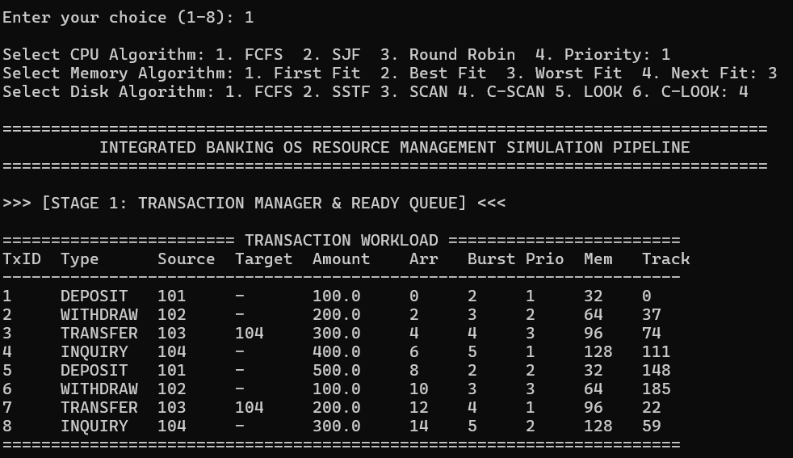
*Figure 1: Clean 8-option interactive simulator menu allowing user navigation across all OS subsystems.*

---

### 2. CPU Scheduling Subsystem (Gantt Chart & Metrics)
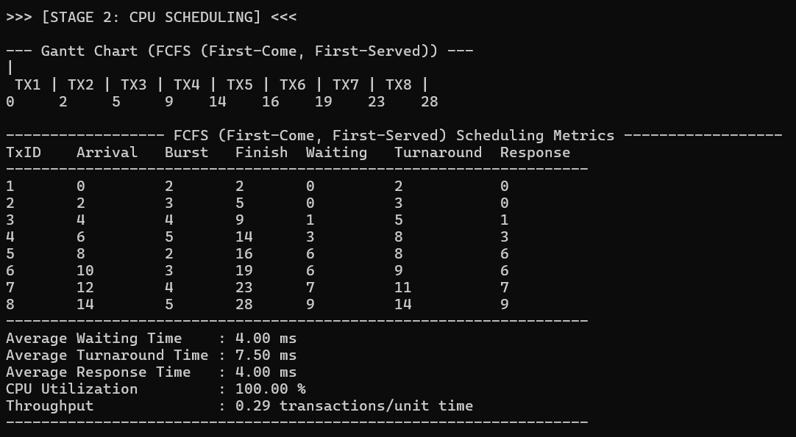
*Figure 2: CPU scheduling comparison, ASCII Gantt chart generation, and turnaround/waiting time computation.*

---

### 3. Synchronization & Deadlock Prevention Module
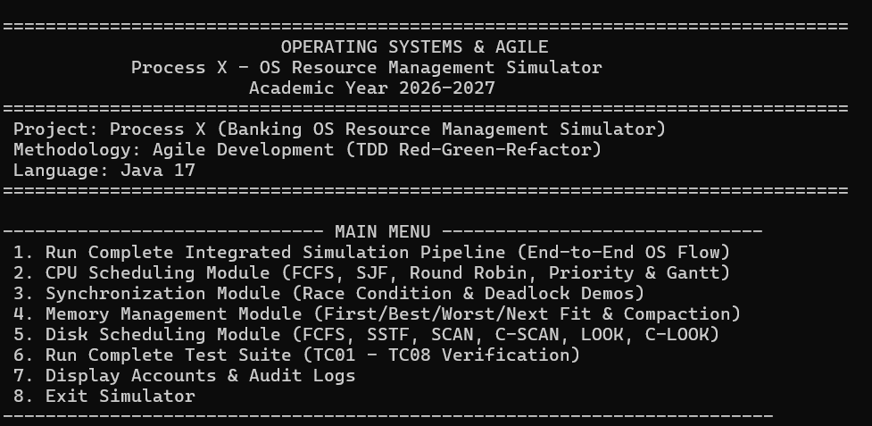
*Figure 3: Demonstration of data race detection (lost updates) and deadlock elimination via lock hierarchy.*

---

### 4. Memory Management & Dynamic Compaction
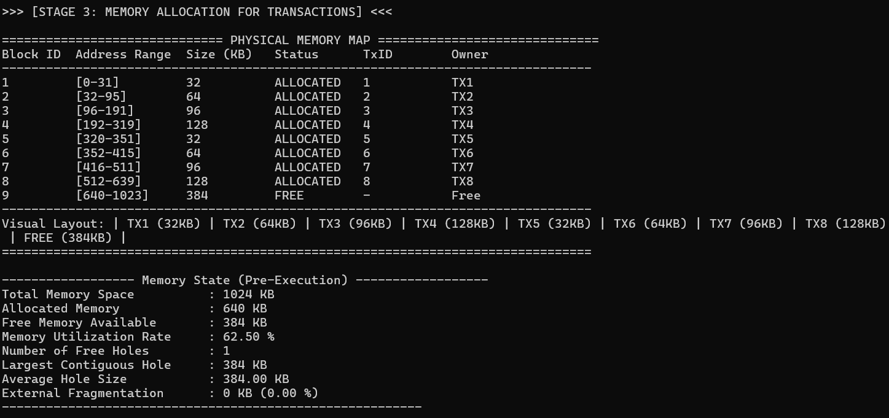
*Figure 4: Dynamic contiguous partitioning map (First-Fit, Best-Fit, Worst-Fit) and compaction to eliminate external fragmentation.*

---

### 5. Disk Scheduling & Head Seek Optimization
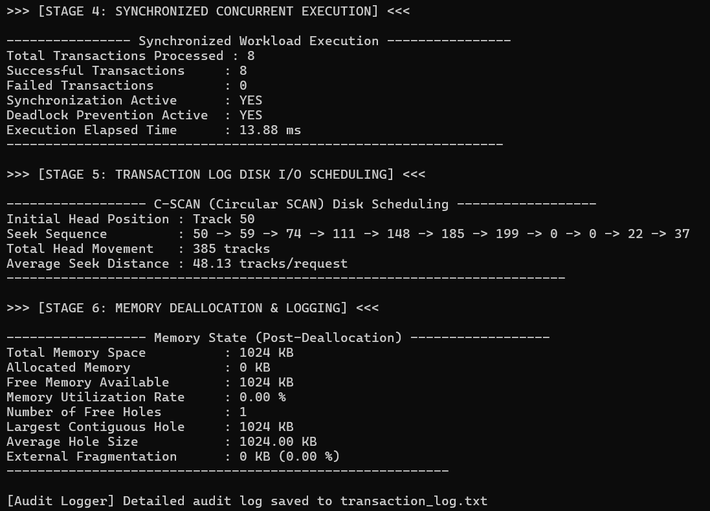
*Figure 5: Disk head movement algorithms (FCFS, SSTF, LOOK, C-LOOK) minimizing track traversal.*

---

### 6. Full Integrated End-to-End Simulation Pipeline
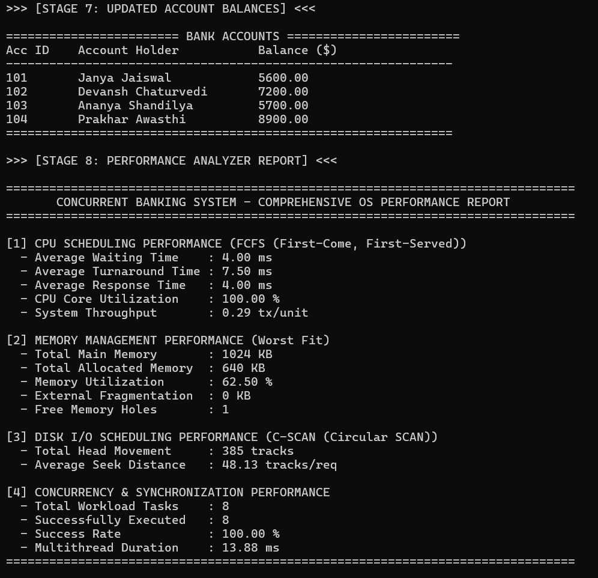
*Figure 6: Complete 8-stage resource management pipeline executing transactions across CPU, Memory, Sync, and Disk.*

---

## 📊 System Architecture & Subsystem Flowcharts

### 1. End-to-End Simulation Pipeline Flowchart

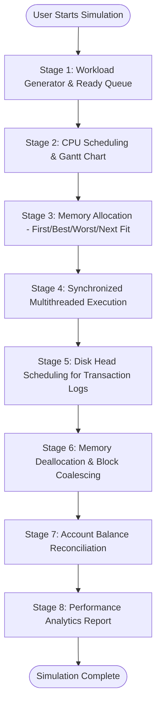

---

### 2. CPU Scheduling Decision & Dispatching Flowchart

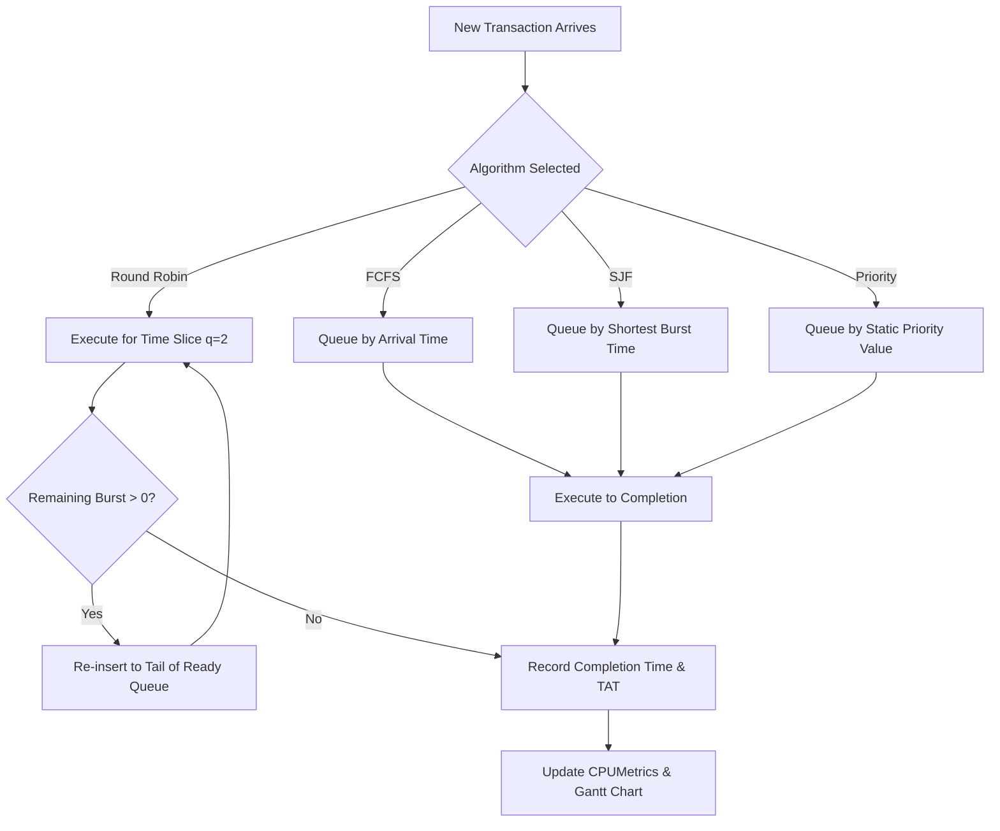

---

### 3. Synchronization & Deadlock-Free Transfer Flowchart

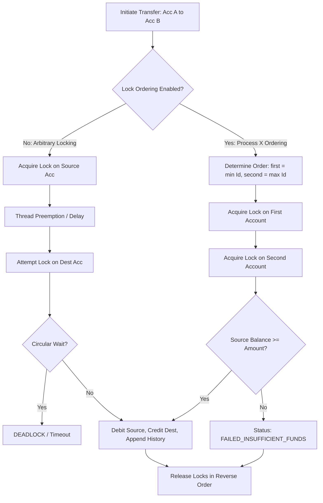

---

### 4. Dynamic Memory Partitioning & Compaction Flowchart

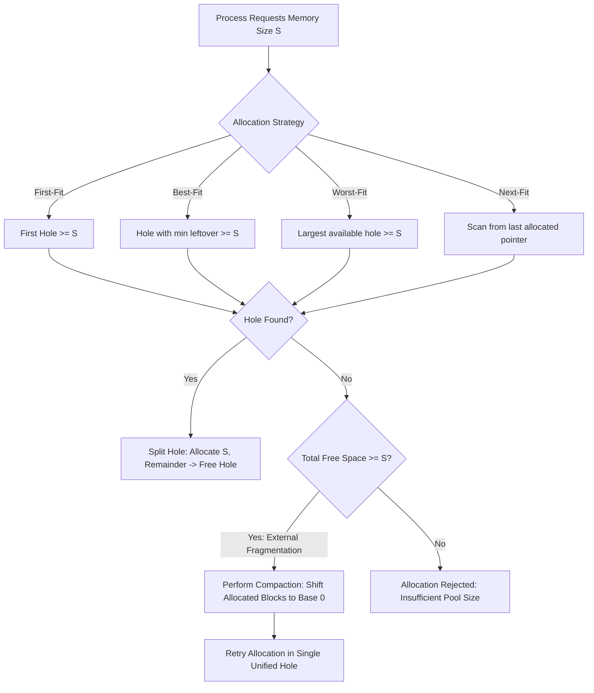

---

### 5. Agile Red-Green-Refactor (RGR) Development Lifecycle

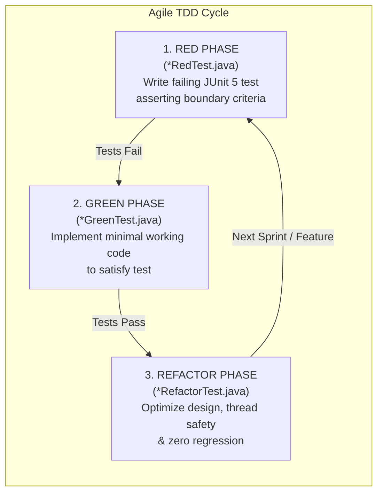

---

## 🎯 Architectural Concept: Why Core Files + 3 RGR Files?

A common question in software reviews and academic vivas is:  
**"Why does each module have a primary engine file (`CpuScheduler.java`) alongside 3 RGR files (`CpuRedTest.java`, `CpuGreenTest.java`, `CpuRefactorTest.java`)?"**

### The Answer: Agile Clean Architecture & Separation of Concerns

1. **The Core Engine Files (`CpuScheduler.java`, `Synchronization.java`, etc.):**
   - Represent **Production Code**.
   - House domain entities (`Transaction`, `Account`, `MemoryBlock`, `DiskOutput`), data structures, and the final production-ready algorithms consumed by the simulation pipeline.

2. **The 3 RGR Sub-Files (`cpu/`, `memory/`, `sync/`, `disk/`):**
   - Represent the **Agile TDD Evolutionary History**:
     - **RED (`*RedTest.java`):** Standard **JUnit 5 test suites**. In Agile TDD, before writing or expanding production code, you write failing tests asserting system requirements and boundary constraints.
     - **GREEN (`*GreenTest.java`):** Minimal working implementation demonstrating code written solely to make the RED tests pass without over-engineering.
     - **REFACTOR (`*RefactorTest.java`):** Architectural optimization (e.g. preemptive queues, compaction, elevator sweeps, deadlock-free lock ordering) with zero regression.

By keeping the tests directly in the feature folders, Process X follows **Feature-Driven / Screaming Architecture**, eliminating redundant external directories while keeping test suites self-contained.

---

## 📁 Project Directory Layout

```
ProcessX/
├── README.md                           # Main project documentation & quickstart
├── run.ps1                             # PowerShell one-click automation script
├── run.bat                             # Windows CMD runner
├── photos/                             # Execution screenshots
│   ├── 01_main_menu.png
│   ├── 02_cpu_scheduling.png
│   ├── 03_synchronization_deadlock.png
│   ├── 04_memory_management.png
│   ├── 05_disk_scheduling.png
│   └── 06_integrated_pipeline.png
├── lib/
│   └── junit-platform-console-standalone-1.10.2.jar  # Bundled standalone JUnit 5 engine
├── src/
│   └── processx/
│       ├── Main.java                   # Simulator CLI entry point & interactive menu
│       ├── CpuScheduler.java           # [PRODUCTION] CPU scheduling engine
│       ├── Synchronization.java        # [PRODUCTION] Concurrency & deadlock prevention engine
│       ├── MemoryManagement.java       # [PRODUCTION] Memory allocation & compaction engine
│       ├── DiskScheduling.java         # [PRODUCTION] Disk scheduling & audit logging engine
│       │
│       ├── cpu/                        # Sprint 1: CPU Scheduling
│       │   ├── CpuRedTest.java         # RED: JUnit 5 test suite
│       │   ├── CpuGreenTest.java       # GREEN: Minimal FCFS/SJF implementation
│       │   └── CpuRefactorTest.java    # REFACTOR: Round Robin & Priority optimization
│       │
│       ├── memory/                     # Sprint 2: Memory Management
│       │   ├── MemoryRedTest.java      # RED: JUnit 5 test suite
│       │   ├── MemoryGreenTest.java    # GREEN: Dynamic partition allocation
│       │   └── MemoryRefactorTest.java # REFACTOR: Coalescing & Compaction
│       │
│       ├── sync/                       # Sprint 3: Synchronization
│       │   ├── SyncRedTest.java        # RED: JUnit 5 test suite
│       │   ├── SyncGreenTest.java      # GREEN: Mutual exclusion thread safety
│       │   └── SyncRefactorTest.java   # REFACTOR: Ascending lock ordering (deadlock-free)
│       │
│       └── disk/                       # Sprint 4: Disk Scheduling
│           ├── DiskRedTest.java        # RED: JUnit 5 test suite
│           ├── DiskGreenTest.java      # GREEN: SSTF seek minimization
│           └── DiskRefactorTest.java   # REFACTOR: LOOK & C-LOOK elevator algorithms
└── bin/                                # Compiled Java bytecode (.class)
```

---

## 🔄 Agile TDD Matrix & Test Coverage

| Sprint | Subsystem | RED Phase (JUnit 5 Test File) | GREEN Phase (Working Code) | REFACTOR Phase (Clean Optimization) |
|---|---|---|---|---|
| **Sprint 1** | **CPU Scheduling** | `CpuRedTest.java`<br>• `testScheduleFCFS()`<br>• `testScheduleSJFNonPreemptive()`<br>• `testScheduleRoundRobin()`<br>• `testSchedulePriority()` | `CpuGreenTest.java`<br>FCFS and non-preemptive SJF queue. | `CpuRefactorTest.java`<br>Round Robin time-slicing ($q=2$), Priority scheduling, Gantt chart. |
| **Sprint 2** | **Memory Management** | `MemoryRedTest.java`<br>• `testAllocationExceedingCapacityFails()`<br>• `testDynamicPartitionAllocation()`<br>• `testDeallocationAndCompaction()` | `MemoryGreenTest.java`<br>Dynamic partition allocation across strategies. | `MemoryRefactorTest.java`<br>Dynamic coalescing and memory compaction (0 KB fragmentation). |
| **Sprint 3** | **Synchronization** | `SyncRedTest.java`<br>• `testConcurrentWithdrawalConsistency()`<br>• `testThreadSafeBalancePreservation()`<br>• `testDeadlockPrevention()`<br>• `testInsufficientBalanceRejection()` | `SyncGreenTest.java`<br>Mutual exclusion monitors for 100% balance consistency. | `SyncRefactorTest.java`<br>Ascending Account ID lock ordering eliminating circular wait deadlocks. |
| **Sprint 4** | **Disk Scheduling** | `DiskRedTest.java`<br>• `testScheduleFCFS()`<br>• `testScheduleSSTFReducesHeadMovement()`<br>• `testScheduleLOOK()`<br>• `testTransactionLoggerFileWrite()` | `DiskGreenTest.java`<br>SSTF reducing head travel from 640 to 236 tracks. | `DiskRefactorTest.java`<br>LOOK & C-LOOK elevator sweeps preventing starvation. |

---

## 👥 GitHub Contribution & Upload Guide (3 Team Members)

To make sure every team member receives full credit in GitHub commit graphs and code reviews, follow this exact upload assignment:

### 👤 Member 1: You (Lead Integrator & Memory Management)
- **Role:** Project architecture, integrated pipeline, dynamic memory allocation & compaction.
- **Files to Upload / Commit:**
  1. `README.md`
  2. `EXPLAINER.md`
  3. `run.ps1`
  4. `run.bat`
  5. `photos/` (all screenshot images)
  6. `lib/junit-platform-console-standalone-1.10.2.jar`
  7. `src/processx/Main.java`
  8. `src/processx/MemoryManagement.java`
  9. `src/processx/memory/MemoryRedTest.java`
  10. `src/processx/memory/MemoryGreenTest.java`
  11. `src/processx/memory/MemoryRefactorTest.java`
- **Suggested Commit Message:**  
  `feat: initialize Process X simulator, integrated pipeline and memory management module`

---

### 👤 Member 2: Kanishk (CPU Scheduling Module)
- **Role:** CPU core scheduling algorithms, arrival queues, and time-slicing.
- **Files to Upload / Commit:**
  1. `src/processx/CpuScheduler.java`
  2. `src/processx/cpu/CpuRedTest.java`
  3. `src/processx/cpu/CpuGreenTest.java`
  4. `src/processx/cpu/CpuRefactorTest.java`
- **Suggested Commit Message:**  
  `feat(cpu): implement CPU scheduling engine and Sprint 1 RGR test suite`

---

### 👤 Member 3: Janya (Disk Scheduling & Synchronization Modules)
- **Role:** Disk head seek optimization, persistent logging, semaphore throttling & deadlock prevention.
- **Files to Upload / Commit:**
  1. `src/processx/DiskScheduling.java`
  2. `src/processx/disk/DiskRedTest.java`
  3. `src/processx/disk/DiskGreenTest.java`
  4. `src/processx/disk/DiskRefactorTest.java`
  5. `src/processx/Synchronization.java`
  6. `src/processx/sync/SyncRedTest.java`
  7. `src/processx/sync/SyncGreenTest.java`
  8. `src/processx/sync/SyncRefactorTest.java`
- **Suggested Commit Message:**  
  `feat(sync-disk): add concurrency synchronization, deadlock avoidance, disk scheduling and RGR tests`

---

## 🚀 Quickstart & Execution Guide

### 1. Compile Everything
```powershell
javac -cp "bin;lib\*" -d bin (Get-ChildItem -Path src -Filter *.java -Recurse | Select-Object -ExpandProperty FullName)
```

### 2. Run All 15 JUnit Tests
```powershell
.\run.ps1 -Mode junit
```

### 3. Run Individual Module JUnit Tests
```powershell
.\run.ps1 -Mode cpu-red
.\run.ps1 -Mode mem-red
.\run.ps1 -Mode sync-red
.\run.ps1 -Mode disk-red
```

### 4. Run Interactive OS Simulator
```powershell
.\run.ps1
```

### 5. Run Full Test Suite (TC01 - TC08)
```powershell
.\run.ps1 -Mode test
```

---

## 📖 In-Depth Documentation
For detailed viva questions, mathematical scheduling formulas ($TAT, WT, RT, \text{throughput}$), and concurrency lock-hierarchy proofs, refer to [EXPLAINER.md](file:///c:/Users/cdeva/OneDrive/Desktop/ProcessX/EXPLAINER.md).
